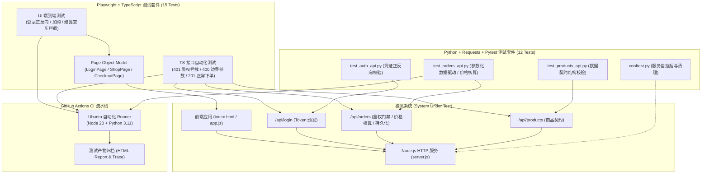

# QA Automation Testing Portfolio | 自动化测试工程化实战项目

[](https://github.com/orimni/qa-playwright-starter/actions/workflows/playwright.yml)


本项目是一个面向企业级质量保障标准的自动化测试工程实战项目，涵盖 **Playwright (TypeScript) UI/API 自动化** 与 **Python + Requests + Pytest 接口自动化** 双技术栈闭环。项目包含完整的测试用例分层设计、Page Object Model（POM）架构、数据驱动测试、鉴权安全门禁验证、金额核算断言以及 GitHub Actions 自动化持续集成流水线。

---

## 🏗️ 整体测试架构与设计



---

## 🌟 核心特性与技术亮点

### 1. 严格的鉴权与安全门禁拦截（401 Unauthorized）
- 下单接口 `/api/orders` 与详情查询接口受到 `Bearer Token` 严格保护；
- 覆盖**未携带 Token**、**伪造/过期 Token** 反向拦截用例，验证接口安全防护契约。

### 2. 数据驱动测试（Data-Driven Testing）
- 抽象测试数据与执行逻辑，利用数据驱动循环（Playwright）与 `@pytest.mark.parametrize`（Pytest）批量覆盖异常边界：
  - 空购物车数组 `[]`
  - 含有不存在的商品 ID `[999]`
  - 参数格式异常（字符串代替数组 `'1'`）
  - 合法与未知商品混合数组 `[1, 999]`

### 3. 全链路状态与价格核算一致性验证
- 验证商品组合下单时的后端动态总额计算（例如购买商品 1 [¥129] 与商品 2 [¥399]，断言返回总价等于 `528.0`）；
- 在创建订单（`201 Created`）后，通过订单号立即反查订单详情接口（`200 OK`），确保业务数据落盘一致性。

### 4. 双语言测试工程对齐（TypeScript & Python）
- **TypeScript + Playwright**：适合全栈端到端测试与 UI 用户旅程模拟，自带录制、Trace、视频和 HTML 报告；
- **Python + Requests + Pytest**：适合轻量、高效的后端接口自动化与 CI 冒烟测试，通过 fixture 实现服务自启动与清理。

---

## 📁 目录结构

```text
├── .github/workflows/
│   └── playwright.yml         # GitHub Actions 自动化双测试流水线配置
├── demo-app/                  # 本地全真模拟电商系统
│   ├── public/                # 前端 HTML/CSS/JS (支持 data-testid 稳定定位)
│   └── server.js              # 包含 Token 校验、商品契约、订单持久化的 Node 服务
├── tests/                     # Playwright TypeScript 测试套件
│   ├── pages/                 # Page Object Model (LoginPage, ShopPage, CheckoutPage)
│   ├── ui/                    # UI 自动化测试用例
│   └── api/                   # API 接口自动化测试用例
├── python-tests/              # Python + Requests + Pytest 接口自动化套件
│   ├── conftest.py            # 全局 Fixture 与服务自拉起生命周期管理
│   ├── test_auth_api.py       # 登录鉴权接口测试
│   ├── test_products_api.py   # 商品接口契约与数据类型断言
│   └── test_orders_api.py     # 订单鉴权、数据驱动与状态闭环测试
├── package.json               # Node 依赖与一键测试脚本
├── playwright.config.ts       # Playwright 运行器与报告配置
├── pytest.ini                 # Pytest 运行与断言配置
└── requirements.txt           # Python 依赖项
```

---

## 🚀 快速上手与运行指南

### 1. 环境准备
- Node.js 20+
- Python 3.10+

### 2. 安装依赖
```bash
# 安装 Node 依赖与 Playwright 浏览器内核
npm install
npx playwright install chromium

# 安装 Python 自动化依赖
pip install -r requirements.txt
```

### 3. 执行测试

| 测试场景 | 执行命令 | 说明 |
| :--- | :--- | :--- |
| **一键运行全部测试** | `npm run test:all` | 先后运行 Playwright (15项) 与 Pytest (12项) |
| **运行 Playwright 全部测试** | `npm test` | 自动化启动本地服务并并发执行 UI/API 测试 |
| **只运行 UI 自动化** | `npm run test:ui` | 仅执行登录、加购、结算流程 |
| **只运行 Playwright 接口测试** | `npm run test:api` | 快速回归 TS 接口断言 |
| **运行 Python Pytest 接口测试** | `npm run test:python` | 执行 Pytest 接口测试套件 (自动拉起服务) |
| **查看图形化测试报告** | `npm run report` | 打开 Playwright HTML 测试报告与 Trace |

---

## 💼 简历表达与面试对标

在面试中谈及该项目时，建议使用如下表述：

> “我自主搭建了一套端到端质量保障工程，基于 **Playwright + TypeScript** 实现了 UI 全链路的 Page Object Model 封装，并结合 **Python + Requests + Pytest** 搭建了接口自动化套件。针对订单交易核心链路，我重点设计了 **Token 鉴权失效拦截（401）**、**数据驱动边界校验（400）** 以及 **订单价格计算与数据落盘一致性核验**。全套测试集成了 **GitHub Actions CI**，在代码 Push 和 PR 时实现双环境自动触发回归与产物归档。”
